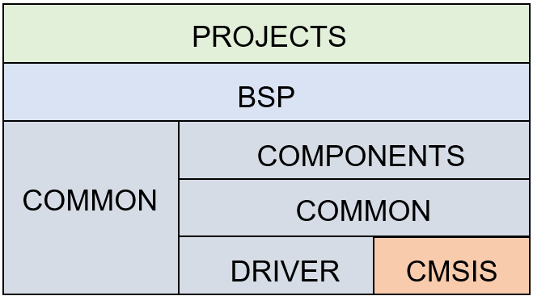
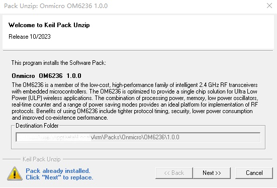
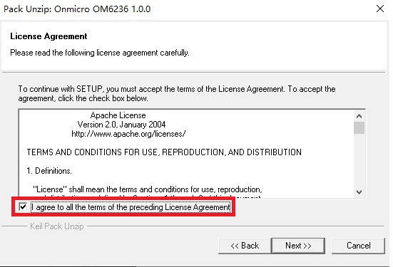
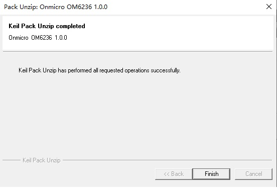
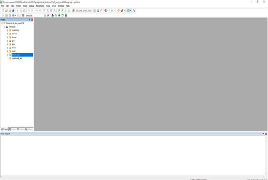
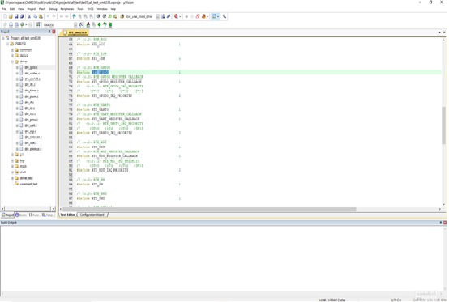

# README for the SDK

## 项目简介
开发语言： C语言, python3
适用芯片： 适用于OM62XX系列
编译器支持: Keil编译器

OM62XX SDK编译构建系统是一个基于python3和scons的组件化构建系统，用户可以根据需求通过Kconfig按组件配置、裁剪工程，使用Makefile构建工程。同时，为了方便客户使用，在projects/xxx/下也提交了keil工程，用户可以由此构建自己的项目。

OM62XX SDK的框架如下：

* COMMON：通用数据结构、软件组件和定义等。
* COMPONENTS：包含evt调度、cherry_usb、exble2协议栈以及电源管理等模块。
* DEVICE：系统硬件描述、启动文件等。
* CMSIS：ARM的通用微控制器软件接口标准，可以参考[ARM CMSIS官方网站介绍](https://www.arm.com/technologies/cmsis)。
* DRIVER：硬件外设驱动
* BSP：板级器件驱动等
* PROJECT：应用层工程

## SDK文件结构说明

* bsp：BSP层相关文件。
* common：COMMON层相关文件。
* components：COMPONENTS层相关文件。
* docs：文档图片等。
* hal
  * CMSIS：CMSIS层相关文件。
  * device：DEVICE层相关文件。
  * driver：DRIVER层相关文件。
* projects
  * all_test： 外设功能测试&参考代码
  * mouse_demo:  鼠标应用demo
  * ble_nus：蓝牙透传方案
  * dtm_test：用于对BLE射频性能进行DTM测试
  * usb_demo：USB应用demo
* utils：其他文件

## 安装指南

### 获取Keil MDK

Keil MDK是一个面向ARM Cortex-M系列MCU的集成开发环境，用户需要正确获取和安装Keil MDK。获取最新版本的Keil MDK，并了解相关操作，可以前往[Keil官方网站](https://www.keil.com/)。

### 安装Onmicro CMSIS Pack

在SDK中[Keil Pack目录](utils/packKEIL)下包含各个芯片的CMSIS Pack，命名为 `Onmicro.OM62xx.x.x.x.pack`。选择与所用芯片对应的Pack，双击打开后界面如下：

点击Next后界面如下：

勾选同意协议后，点击Next开始安装，安装结束后界面如下：

点击Finish完成安装。

## 快速开始
projects/xxx/有已提交的keil工程，双击打开keil工程，根据需求构建自己的项目:

如打开om6236的all_test工程(projects\all_test\keil\all_test_om6236.uvprojx)，，界面如下图所示：

不同外设描述和驱动可以通过 `project/xxx/config/RTE_om62xx`文件进行裁剪，以减少空间占用。在Keil内打开[all_test工程RTE文件](projects\all_test\config\RTE_om6236.h)，界面如下图所示：

以GPIO0为例，在RTE文件中去除GPIO0外设，需要将`RTE_GPIO0`宏修改为0。

配置完成后，进行编译下载即可。
